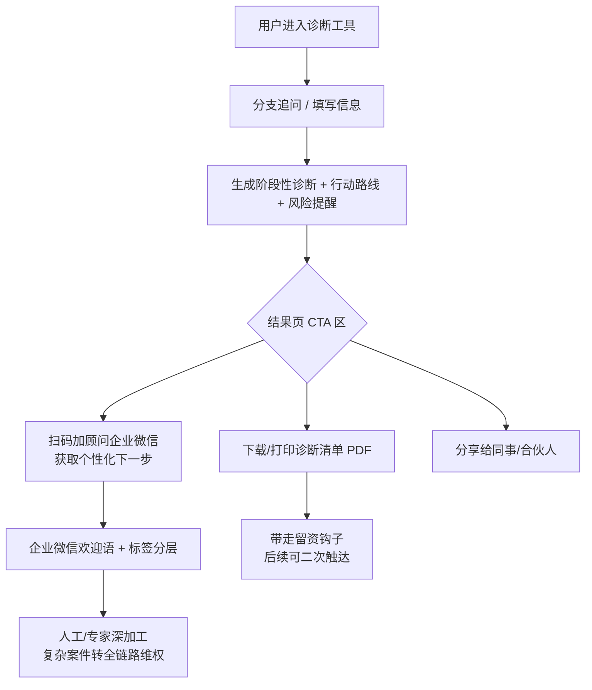

# 诊断结果页 → 企业微信承接（CTA 闭环设计）

> 目标：用户用完诊断工具后，顺滑沉淀到企业微信私域（opt-in，合规），形成"公域科普 → 网站自测 → 私域承接 → 专家深加工"的漏斗。
> 现状：站内已有 `/ip-contact-qr`（企业微信二维码）与 `/login`，但结果页的 CTA 入口可能不够显眼，需强化。

## 流程图

## 结果页 CTA 区布局建议

1. **主 CTA（最强）**：企业微信二维码卡片，文案"扫码加顾问，领取你的个性化下一步方案"。二维码使用 `/ip-contact-qr` 提供的企业微信码。
2. **次 CTA**：按钮"下载诊断清单（PDF）"——既是交付物，也是留资钩子（下载前可轻量收集邮箱/手机号，**需勾选同意**）。
3. **分享 CTA**："把这份自测发给合伙人/HR"——裂变，低合规风险。

## 各工具结果页 CTA 文案模板

- **IP 风险诊断**："侵权性质与下一步已经理清。扫码加知识产权顾问，针对你的具体情况给一份可执行的维权/抗辩清单。"
- **离婚风险诊断**："你的风险点已标出。扫码加顾问，领取《离婚前准备清单》，重大事项建议进一步沟通。"
- **公司风险诊断**："股权/合同/用工风险已初筛。扫码加企业法律顾问，把自测结果转成可落地的整改清单。"
- **税务风险诊断**："税务风险点已提示。扫码加顾问，针对发票/个税问题给合规建议（涉及补税请以税务机关认定为准）。"
- **劳动风险诊断**："用工风险已梳理。扫码加顾问，领取《用工合规自查表》。"

## 企业微信欢迎语（首次添加）

> 你好，我是【司法资源工具】的法律顾问助手。你刚完成的自测结果我已收到参考。
> 为了给你更贴合的建议，可以简单说下：你目前遇到的是哪类问题？（如：商标被侵权 / 劳动纠纷 / 公司股权）
> 说明：自测结果仅供参考，**不构成正式法律意见**；复杂或涉及金额较大的事项，建议由执业律师/律所跟进。

## 合规要点（务必保留）

- 结果页全程保留"**不构成正式法律意见 / 结果仅供参考**"免责标识。
- 企业微信扫码是用户**主动 opt-in**，合规；不做未授权短信/电话跟进。
- 若下载清单前收集信息，必须：明确告知用途 + 勾选同意 + 提供撤回/退订入口（呼应《个人信息保护法》）。
- CTA 文案不承诺结果，不用"包赢/稳下架/100%通过"等绝对化用语。
- 私域承接话术统一，避免不同顾问口径不一导致合规风险。

## 前端落地提示

- 结果页以组件形式渲染 CTA 区，二维码图片走 `/ip-contact-qr` 静态资源。
- "下载清单"优先前端生成（如 html2pdf），避免后端存敏感数据。
- 企业微信标签：按来源工具打标签（ip / divorce / company / tax / labor），便于分层运营。
